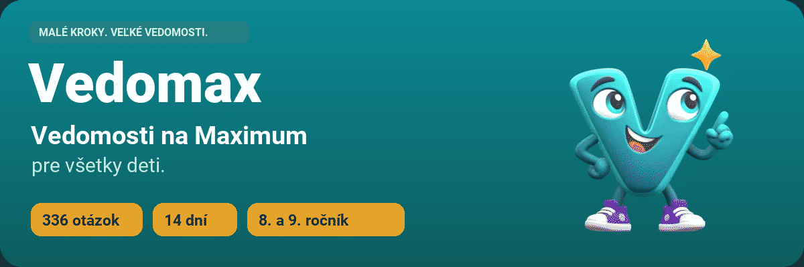
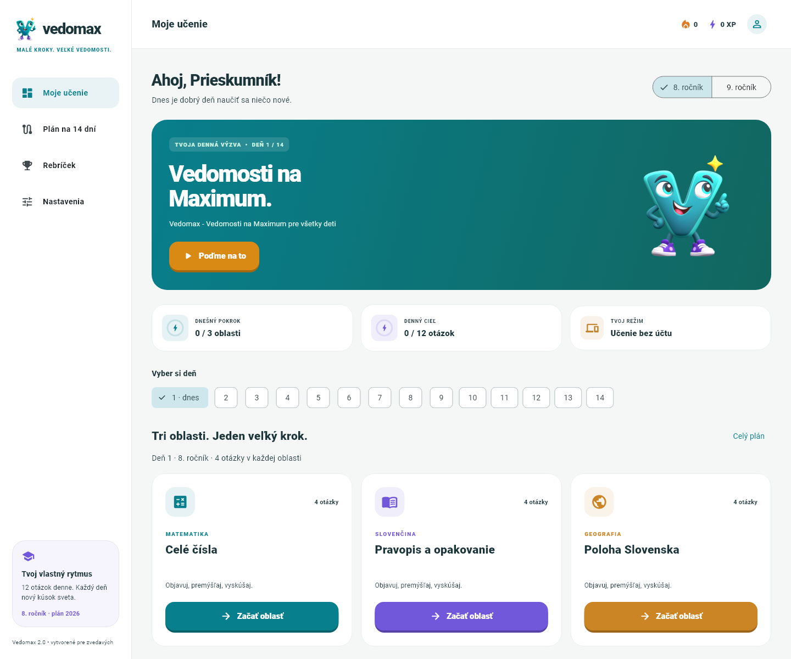
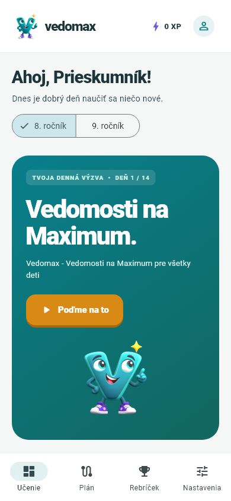
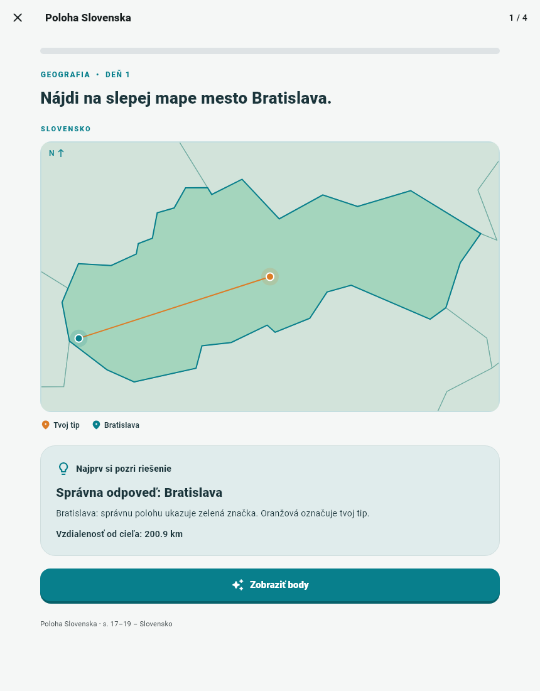
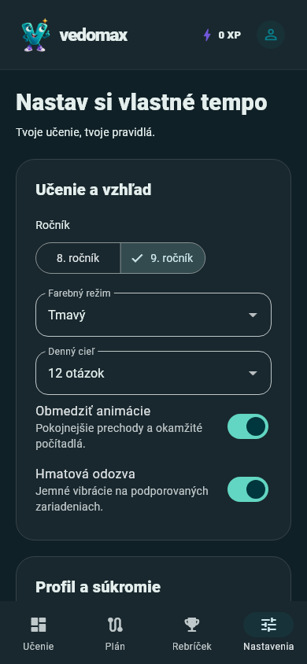
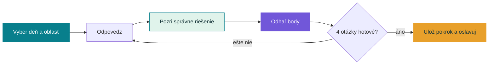
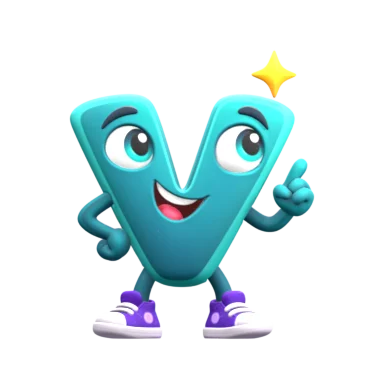

<div align="center">

<picture>
  <source media="(prefers-reduced-motion: reduce)" srcset="docs/media/hero.png">
  
</picture>

<br>

[](pubspec.yaml)
[](lib)
[](docs/CURRICULUM.md)
[](LICENSE)

**Malé každodenné výzvy. Veľká radosť z poznania.**

Flutter aplikácia pre ôsmakov a deviatakov: matematika, slovenčina a geografia,
živý 3D maskot a vysvetlenie každej odpovede.

<a href="#spustenie">🚀 Spustiť aplikáciu</a> ·
<a href="#nahliadni">👀 Nahliadnuť dovnútra</a> ·
<a href="#ako-sa-hra">🎮 Ako sa hrá</a> ·
<a href="#vyvoj">🛠️ Pre vývojárov</a> ·
<a href="docs/CURRICULUM.md">📚 Učivo</a>

<sub>Uprednostňuješ pokojný obrázok? <a href="docs/media/hero.png">Otvoriť statický titulný náhľad.</a></sub>

</div>

---

## Učenie, na ktoré sa dá kliknúť

| | Vyskúšaj | Čo sa stane |
|---|---|---|
| 🧭 | **Vyber deň** | Prepínaj medzi 14 dňami a nájdi si vlastné tempo. |
| 🃏 | **Otvor kartu predmetu** | Celá karta reaguje na myš, dotyk aj klávesnicu. |
| 🧮 | **Vyrieš krátku výzvu** | Číselné odpovede, výber možností a slepé mapy. |
| 📍 | **Ťukni na mapu** | Uvidíš správnu polohu, svoj tip a vzdialenosť v kilometroch. |
| 💡 | **Pozri si vysvetlenie** | Najprv pochopenie správneho riešenia, potom body. |
| ✨ | **Osláv pokrok** | Počítadlá bodov, krátke konfety a veselý Vedomax. |
| 🌱 | **Nastav si pohodlie** | Svetlá/tmavá téma, cieľ, ročník aj obmedzené animácie. |

**14 dní × 3 oblasti × 4 otázky × 2 ročníky = 336 otázok.**
Každá lekcia má štyri otázky. Všetky dni sú dostupné aj vopred; otázky môžeš opakovať.

<a id="nahliadni"></a>

## 👀 Nahliadni dovnútra

Klikni na náhľad a otvoríš ho v plnej veľkosti.

<table>
  <tr>
    <td align="center" width="76%"><strong>Priestor na objavovanie</strong></td>
    <td align="center" width="24%"><strong>Aj do vrecka</strong></td>
  </tr>
  <tr>
    <td valign="top"><a href="test/goldens/home_desktop.png"></a></td>
    <td valign="top"><a href="test/goldens/home_mobile.png"></a></td>
  </tr>
</table>

<details>
<summary><strong>📍 Odhaľ, ako vyzerá správne riešenie na mape</strong></summary>

<p align="center"><a href="test/goldens/map_feedback.png"></a></p>

Oranžová značka je hráčov tip, zelená správna poloha. Vzdialenosť sa počíta v kilometroch haversinovým vzorcom. Body sa odhalia až po kliknutí na **Zobraziť body**.

</details>

<details>
<summary><strong>🌙 Prezri si tmavý režim a nastavenia</strong></summary>

<p align="center"><a href="test/goldens/settings_dark_mobile.png"></a></p>

Téma, ročník, denný cieľ aj pohybové preferencie sa ukladajú. Obmedzené animácie vypnú priestorové prechody, konfety a pohyb maskota; navigácia a odpovede ostávajú plne použiteľné.

</details>

<a id="ako-sa-hra"></a>

## 🎮 Najprv pochopiť. Potom oslavovať.



<details>
<summary><strong>🏆 Ako sa počítajú body a XP?</strong></summary>

- Správna výberová alebo číselná odpoveď: **100 bodov**.
- Mapa Slovenska: plné body do **10 km**, potom plynulý pokles k nule pri **250 km**.
- Zahraničná mapa: plné body do **70 km**, pokles k nule pri **2 200 km**.
- Jedna oblasť: najviac **400 bodov**, ktoré sa prepočítajú na percentuálny výsledok.
- XP odmeňujú **zlepšenie najlepšieho výsledku**. Opakovanie rovnakého výsledku nepridáva ďalšie XP.
- Séria dní používa miestny dátum **Europe/Bratislava**.

Bez účtu sa pokrok ukladá na tomto zariadení. Prihlásenému hráčovi odpovede hodnotí server; lokálne XP sa do účtu ani rebríčka neimportujú.

</details>

<details>
<summary><strong>👋 Zoznám sa s Vedomaxom</strong></summary>

Maskot vznikol zo zadaného textúrovaného OBJ modelu. Má kostru a dve animácie: pokojné mávanie a oslavu úspechu. Ťuknutie na maskota spustí oslavu.

<p align="center"> </p>

Do Flutteru sa načítavajú priehľadné animácie s celkovou veľkosťou približne **1,36 MB**. Veľký 3D model sa pri otvorení menu nesťahuje. [Ako vznikla animácia →](assets/mascot/README.md)

</details>

<a id="spustenie"></a>

## 🚀 Spustenie za chvíľu

Potrebuješ [Flutter SDK](https://docs.flutter.dev/install/manual) v `PATH` alebo nastavené `FLUTTER_ROOT`.

```sh
flutter pub get
flutter run -d web-server --web-port=3000
```

Otvor **http://127.0.0.1:3000**. Bez účtu môžeš používať všetkých 336 otázok.

<details>
<summary><strong>📦 Radšej používaš npm?</strong></summary>

```sh
npm run dev
```

Tento príkaz spúšťa skutočný Flutter SDK. `npm ci` je potrebné až pre lokálne databázové testy. Launcher nájde Flutter cez `FLUTTER_ROOT`, `PATH` alebo existujúce `%USERPROFILE%\.codex\toolchains\flutter`.

</details>

<details>
<summary><strong>☁️ Zapoj účet a synchronizáciu cez Supabase</strong></summary>

Skopíruj [.env.example](.env.example) do `.env.supabase.json` a doplň URL projektu a **publishable** kľúč. Lokálny konfiguračný súbor je v `.gitignore`.

```sh
flutter run -d web-server --web-port=3000 --dart-define-from-file=.env.supabase.json
```

`npm run dev` načíta tento súbor automaticky, ak existuje. Do klienta nikdy nevkladaj `service_role` kľúč. Rebríček je voliteľný a zobrazuje iba prezývku a XP.

Pre novú databázu použi poradie: základná migrácia → `supabase/seed.sql` → migrácia `daily_learning_v2`. Existujúci pripojený projekt už tento obsah má. Podrobnosti sú v [návode pre vývoj](docs/DEVELOPMENT.md) a [nastavení prihlásenia](docs/AUTH_SETUP.md).

</details>

<a id="vyvoj"></a>

## 🛠️ Pod kapotou

| Vrstva | Čo používa |
|---|---|
| Rozhranie | Flutter · Material 3 · responzívne rozloženie |
| Pohyb | Flutter animácie · dotyk/myš/klávesnica · 3D render maskota |
| Lokálny pokrok | SharedPreferences · oddelený režim bez účtu |
| Účty a výsledky | Supabase Auth · PostgreSQL · RLS · serverové RPC |
| Obsah | Jeden JSON zdroj · 84 lekcií · vysvetlenie pri každej otázke |
| Overenie | Unit, widget a render testy · izolované databázové testy |

<details>
<summary><strong>✅ Spusti kontroly a zostavenie</strong></summary>

```sh
npm ci
npm run lint
npm test
npm run test:db
npm run build
```

Výstup: **`build/web`**. Engine aj fonty sú pribalené lokálne. `npm run test:db` používa izolovaný PostgreSQL cez PGlite, nepripája sa k živej databáze.

```sh
python scripts/package_web.py
```

Vytvorí ZIP v `output/` s webovou aplikáciou a konfiguráciou Firebase. Publikovanie je samostatný krok: [Firebase Hosting →](docs/FIREBASE.md). Presný rozsah overenia: [VALIDATION.md →](docs/VALIDATION.md).

</details>

<details>
<summary><strong>🗂️ Kam sa pozrieť v kóde?</strong></summary>

```text
lib/
  screens/       menu, lekcia, účet a nastavenia
  widgets/       maskot, mapy, karty a animácie
  services/      synchronizácia a lokálny pokrok
  models/        otázky a pravidlá hodnotenia
assets/
  content/       336 otázok a súradnice miest
  mascot/        animácie a statický 3D render
supabase/        migrácie, hodnotenie a bezpečnostné kontroly
test/           správanie aplikácie a render náhľady
```

Učebný obsah: [fortnight.json](assets/content/fortnight.json). Pri úprave už vydaných otázok vytvor novú dátovú migráciu; neprepisuj nasadenú históriu.

</details>

## 📚 Dokumentácia a pôvod obsahu

[**Učivo a plán**](docs/CURRICULUM.md) · [**Vývoj**](docs/DEVELOPMENT.md) · [**Účty**](docs/AUTH_SETUP.md) · [**Nasadenie**](docs/FIREBASE.md) · [**Overenie**](docs/VALIDATION.md) · [**Ďalšie kroky**](docs/ROADMAP.md)

Otázky sú autorské precvičovanie podľa predmetových štandardov pre 2. stupeň ZŠ; nejde o ministerskú certifikáciu ani úplné pokrytie všetkých predmetov. Použitie prispôsob školskému ŠkVP.

Mapy: [Natural Earth](assets/maps/ATTRIBUTION.md), public domain. Súradnice: GeoNames, CC BY 4.0. Font Roboto má [priloženú licenciu](assets/fonts/roboto_license.txt). Logo a animácie: [pôvod a spracovanie](assets/brand/README.md).

---

<div align="center">
<strong>Vedomax - Vedomosti na Maximum pre všetky deti</strong><br>
<sub>Vytvorené pre zvedavých. Jeden malý krok každý deň.</sub>
</div>
